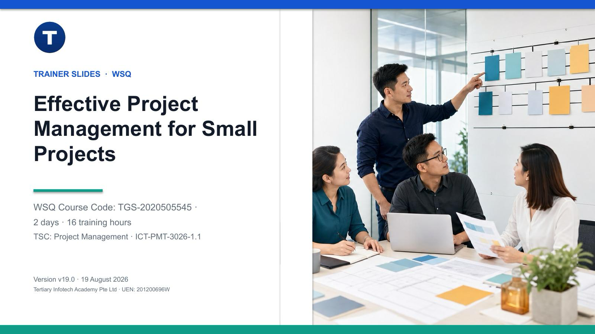

# Effective Project Management for Small Projects

WSQ courseware for leading a small project through its complete lifecycle: initiation, planning, execution, monitoring and controlling, and closure.

| Course detail | Information |
|---|---|
| Course code | `TGS-2020505545` |
| Programme | WSQ |
| Duration | 2 days / 16 hours, including 2 hours of assessment |
| Skills Framework | Project Management — `ICT-PMT-3026-1.1` |
| Registration | [View course details and register](https://www.tertiarycourses.com.sg/wsq-effective-project-management-for-small-projects.html) |
| Funding | See the course page for current funding and eligibility. |
| Courseware version | v19.0 |

## About the course

The course focuses on the particular challenges and constraints of smaller projects: setting clear objectives, planning scope, schedule and budget, allocating resources, tracking progress, managing risk and stakeholders, and closing the project cleanly. All activities use one connected Singapore SME case, the HarbourHub Fresh Click & Collect Pilot.

## Learning outcomes

- **LO1:** Develop project scope and team to initiate the facilitation of a small project.
- **LO2:** Develop a project plan based on the project scope.
- **LO3:** Utilise appropriate methods and tools to track and drive a project.
- **LO4:** Identify and manage project risks.
- **LO5:** Collaborate with project stakeholders.
- **LO6:** Deploy resources for the project.
- **LO7:** Track project deliverables and correct misalignment.

## Topics covered

1. Initiation of a Project
2. Develop a Project Plan
3. Apply Methods and Tools to Drive a Project
4. Manage Project Risk
5. Collaborate with Stakeholders
6. Deploy Resources
7. Track Project Deliverables and Correct Misalignments

## Activities

See the [activity index](activities/README.md) for the running case, timings and tool files.

1. [Screen and Select the HarbourHub Pilot](activities/activity-01-screen-and-select-the-harbourhub-pilot/)
2. [Authorise the Pilot and Run the Kickoff Gate](activities/activity-02-authorise-the-pilot-and-run-the-kickoff-gate/)
3. [Discover Requirements and Map Acceptance Evidence](activities/activity-03-discover-requirements-and-map-acceptance-evidence/)
4. [Build the Scope Baseline with WBS and Dictionary](activities/activity-04-build-the-scope-baseline-with-wbs-and-dictionary/)
5. [Develop the Integrated Schedule and Cost Baseline](activities/activity-05-develop-the-integrated-schedule-and-cost-baseline/)
6. [Tailor the Delivery Method and Quality Plan](activities/activity-06-tailor-the-delivery-method-and-quality-plan/)
7. [Build the Risk Register and Fund Responses](activities/activity-07-build-the-risk-register-and-fund-responses/)
8. [Align Stakeholders, Accountability and Communications](activities/activity-08-align-stakeholders-accountability-and-communications/)
9. [Deploy Resources and Resolve the Bottleneck](activities/activity-09-deploy-resources-and-resolve-the-bottleneck/)
10. [Diagnose the Pilot Quality Failure](activities/activity-10-diagnose-the-pilot-quality-failure/)
11. [Control Performance, Issues and Change](activities/activity-11-control-performance-issues-and-change/)
12. [Accept, Handover and Close the Project](activities/activity-12-accept-handover-and-close-the-project/)

## Public package contents

- [Trainer slide deck (PPTX)](courseware/WSQ%20-%20Master%20Trainer%20Slides%20-%20Effective%20Project%20Management%20for%20Small%20Projects%20-%20v19.0.pptx) and [slide PDF](courseware/WSQ%20-%20Master%20Trainer%20Slides%20-%20Effective%20Project%20Management%20for%20Small%20Projects%20-%20v19.0.pdf)
- [Learner Guide (DOCX)](courseware/LG-Effective%20Project%20Management%20for%20Small%20Projects-v19.0.docx), [Learner Guide (PDF)](courseware/LG-Effective%20Project%20Management%20for%20Small%20Projects-v19.0.pdf) and [Learner Guide (Markdown)](LG-Effective%20Project%20Management%20for%20Small%20Projects.md)
- [Lesson Plan (DOCX)](courseware/LP-Effective%20Project%20Management%20for%20Small%20Projects-v19.0.docx) and [Lesson Plan (PDF)](courseware/LP-Effective%20Project%20Management%20for%20Small%20Projects-v19.0.pdf)
- [Activity packs](activities/) with worksheets, datasets and editable project tools for selection, business cases, charters, requirements, WBS, schedules, budgets, quality, risk, stakeholders, RACI, resources, change, acceptance and handover.
- [Change log](courseware/CHANGELOG.md)

Detailed procedures are kept in the Learner Guide and activity packs; the slides focus on concepts, decision frameworks and visual explanation.

## Distribution boundary

This repository publishes the learner-facing courseware only. Assessment papers and answer keys (`assessment/`), source references (`reference/`), and the Facilitator Guide and Assessment Plan are trainer-only and are never pushed to GitHub. Learners download the course material from the LMS at https://lms-tms.tertiaryinfotech.com.

## Provider

Developed and delivered by [Tertiary Infotech Academy Pte Ltd](https://www.tertiarycourses.com.sg/) (UEN 201200696W).
